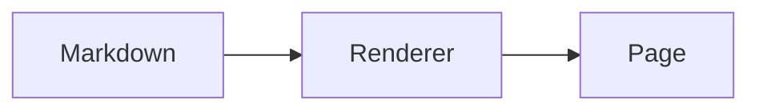
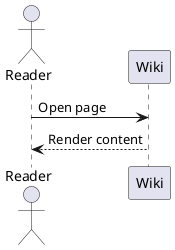

# Markdown and Components Test

This page is a visual index of the Markdown features and content components used by SimpleWiki. Each example is rendered, so changes to the theme and renderer can be checked in one place.

## Page index

- [Headings and text](#headings-and-text)
- [Links, images and media](#links-images-and-media)
- [Lists, quotes and tables](#lists-quotes-and-tables)
- [Code and diagrams](#code-and-diagrams)
- [Inline components](#inline-components)
- [Content components](#content-components)
- [Structured data and references](#structured-data-and-references)

## Headings and text

### Heading level 3

#### Heading level 4

##### Heading level 5

###### Heading level 6

Plain text, **bold**, _italic_, _**bold italic**_, ~~strikethrough~~ and `inline code` can appear in one paragraph. Here is an escaped \*asterisk\*, an entity &copy;, and an explicit line break.<br>
This sentence starts on the next line.

The HTML break above creates a line break; this blank line starts a new paragraph.

---

## Links, images and media

An [internal link](/getting-started/installation), an [external link](https://www.markdownguide.org/ "Markdown Guide"), a bare URL <https://example.com>, and a reference style [documentation link][docs-link].

[docs-link]: /documentation/markdown-syntax "Markdown syntax"

### Images

Standard image with alternative text:


Image with a title and a constrained width:

{width="50%"}

Nuxt image component with explicit dimensions and lazy loading:

::nuxt-img{src="/images/demo-image.jpg" alt="Landscape through Nuxt Image" width="300" height="200" loading="lazy"}
::

### Local video

<video src="/simplewiki/videos/bunny.mp4" controls width="100%">
  Your browser does not support HTML5 video.
</video>

### YouTube: default and alternate thumbnail

::youtube{id="d_IFKP1Ofq0"}
::

::youtube{id="d_IFKP1Ofq0" thumb-size="hqdefault"}
::

## Lists, quotes and tables

### Unordered, nested and ordered lists

- First item with **bold** text
- Second item
  - Nested item
  - Another nested item with `code`
- Third item

1. First step
2. Second step
   1. Nested step
   2. Another nested step
3. Third step

### Task list

- [x] Inspect the content
- [ ] Publish the final implementation

### Blockquotes

> A short quotation with **formatting**.
>
> A second paragraph inside the same quote.
>
> > A nested quotation.

### Tables

| Left aligned                          | Centered | Right aligned |
| :------------------------------------ | :------: | ------------: |
| **Bold**                              |  `code`  |            12 |
| [Link](/getting-started/installation) | _Italic_ |           345 |

### Footnote

This sentence has a footnote.[^sample]

[^sample]: A footnote with **Markdown** formatting and a [link](https://example.com).

## Code and diagrams

### Plain fenced code

```
Plain text stays plain.
  Indentation stays visible.
```

### Language, filename and highlighted line

```typescript [example.ts] {2}
const project = "SimpleWiki";
console.log(project);
```

### Indented code

    npm run dev:static

### Mermaid



### PlantUML



## Inline components

### Highlight

Use :highlight[highlighted words] in prose, including **bold :highlight[emphasis]** and a list item:

- A normal item
- An :highlight[important] item

### Keyboard

Single key :keyboard{keys="Enter"}, shortcut :keyboard{keys="Ctrl+Shift+P"}, and platform shortcut :keyboard{keys="Cmd+C"}.

### Badges: every type and custom text

:badge{type="new"} :badge{type="beta"} :badge{type="stable"} :badge{type="deprecated"} :badge{type="info"} :badge

:badge{type="beta"}[Experimental] :badge{type="stable"}[Version 1.0]

## Content components

### Info box: every type

::info-box
The default type is information.
::

::info-box{type="info"}
General **information** with a [link](/getting-started/installation).
::

::info-box{type="tip"}
A helpful tip.
::

::info-box{type="important"}
An important note.
::

::info-box{type="alert"}
An alert or warning.
::

::info-box{type="help"}
Help for the reader.
::

::info-box{type="download"}
A download notice.
::

::info-box{type="todo"}
A task that is still open.
::

::info-box{type="deprecated"}
A deprecated feature.
::

::info-box{type="info" width="60%"}
Custom width: 60%.
::

### Hatnote: icon and no icon

:hatnote[This page is a visual test of the renderer.]

::hatnote{icon=false}
The same note style without an icon, with **Markdown** text.
::

### Pull quote: with and without citation

::pull-quote
Good documentation makes the next step clear.
::

::pull-quote{cite="SimpleWiki test page"}
One page can exercise **many components** at once.
::

### Collapsible: closed, open and default title

::collapsible{title="Closed by default"}
Hidden content with a list:

- First detail
- Second detail
  ::

::collapsible{title="Open by default" open=true}
This content starts expanded. It also contains `inline code`.
::

::collapsible
This example uses the default title.
::

### Accordion: several panels and rich content

::accordion
:::div{title="First panel"}
The first panel contains **formatted text**.
:::
:::div{title="Second panel"}

- A nested list
- Another item
  :::
  :::div{title="Third panel"}
  A [link](/getting-started/installation) inside a panel.
  :::
  ::

### Tabs: multiple labels and nested Markdown

::tabs
:::div{title="npm"}

```bash
npm install simplewiki
```

:::
:::div{title="pnpm"}

```bash
pnpm add simplewiki
```

:::
:::div{title="Notes"}
This tab contains **text** and a list:

- One item
- Another item
  :::
  ::

### Steps: named, unnamed and rich content

::steps
:::div{title="Install"}
Install the package.
:::
:::div
This step has no title.
:::
:::div{title="Configure"}
Set up the project with `npm run dev:static`.
:::
::

### Timeline: dated, titled and untitled events

::timeline
:::div{date="2024-01-15" title="First release"}
Initial documentation.
:::
:::div{date="2024-06-01"}
An event without a title.
:::
:::div{date="2025-01-01" title="Updated content"}
**Rich text** and a [link](/getting-started/installation).
:::
::

### Diff: context, removal and addition

::diff
---

lines:

- type: context
  content: "const version = 1"
- type: remove
  content: "const name = 'old'"
- type: add
  content: "const name = 'new'"
- type: context
  content: "export { name, version }"

---

::

### Link card: title only and description

::link-card{to="/getting-started/installation" title="Installation"}
::

::link-card{to="/documentation/markdown-syntax" title="Markdown syntax" description="Read the full syntax guide."}
::

## Structured data and references

### Field table: plain and formatted values

::field-table
---

items:
Project: SimpleWiki
Command: "npm run dev:static"
URL: "https://example.com/api"
Description: "A value with **bold text**, `code`, and a colon: inside it."
---

::

### Reference list: with and without notes

::reference-list
---

items:

- title: Markdown Guide
  url: https://www.markdownguide.org/
  note: Reference for Markdown syntax.
- title: Nuxt Content
  url: https://content.nuxt.com/

---

::

### Inline citations and references: URL, note and plain source

The web was created at CERN. :ref{n="1"} HTTP carries web requests. :ref{n="2"} A printed source can also be cited. :ref{n="3"}

::references
---

items:

- title: The birth of the Web
  url: https://home.cern/science/computing/birth-web
  note: CERN history.
- title: HTTP overview
  url: https://developer.mozilla.org/en-US/docs/Web/HTTP/Overview
- title: Printed reference without a URL
  note: Example of a source without a link.

---

::

### Category list: linked and plain labels

::category-list
---

items:

- label: Getting started
  to: /getting-started/installation
- label: Components
  to: /components/overview
- label: Unlinked category

---

::

### See also: basic and described links

::see-also
---

items:

- title: Installation
  to: /getting-started/installation
- title: Markdown syntax
  to: /documentation/markdown-syntax
  description: Learn the supported Markdown features.
- title: Mermaid documentation
  to: https://mermaid.js.org/
  description: External diagram reference.
  external: true

---

::
